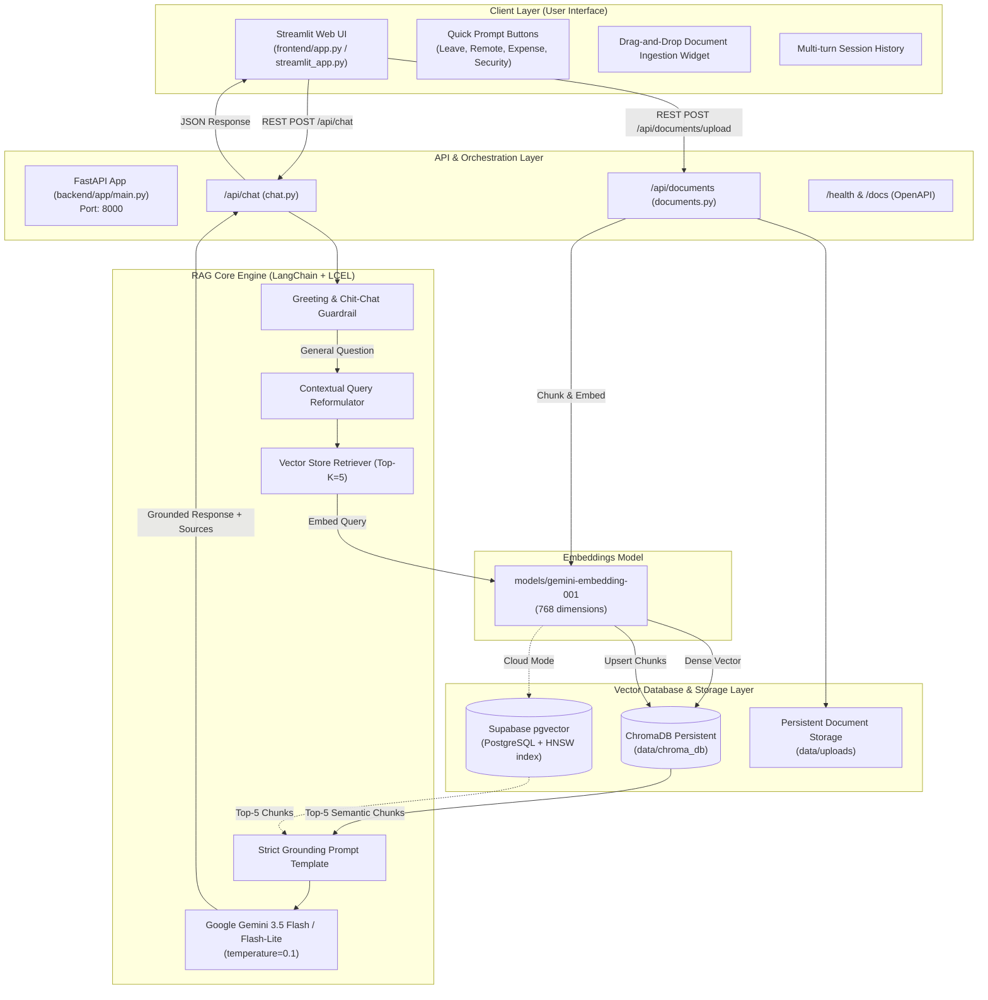
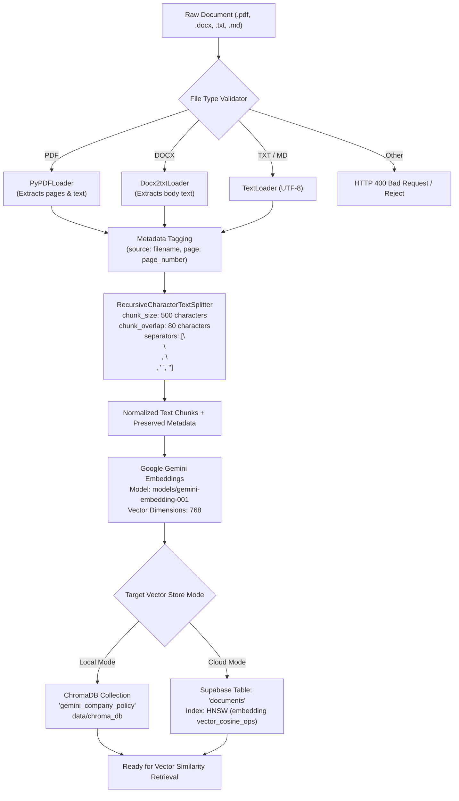
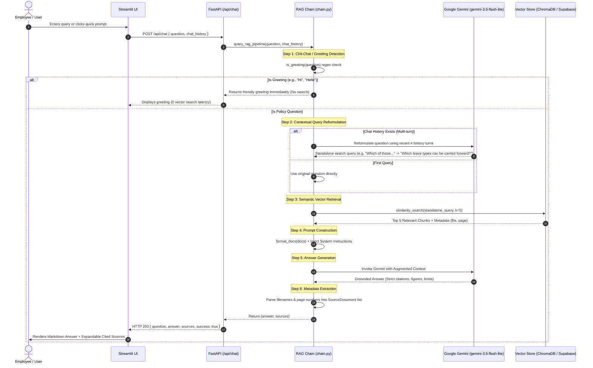
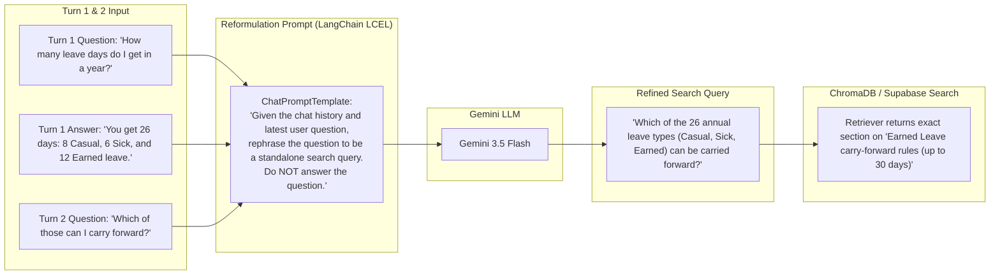
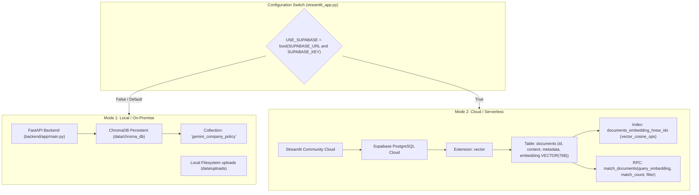
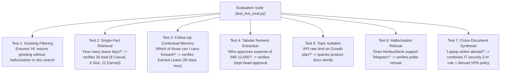

# NimbusDesk AI - Enterprise Policy RAG Architecture & Flow Diagrams

This document outlines the complete architectural design and data flow of the **NimbusDesk AI Enterprise Policy RAG** system.

---

## 1. High-Level System Architecture

The project supports two deployment patterns:
- **Local Microservices Architecture**: [Streamlit Frontend](file:///e:/RAG%20Project/frontend/app.py) communicates over REST API with [FastAPI Backend](file:///e:/RAG%20Project/backend/app/main.py) backed by local [ChromaDB](file:///e:/RAG%20Project/data/chroma_db).
- **Serverless Cloud Architecture**: Single [Streamlit App](file:///e:/RAG%20Project/streamlit_app.py) communicating with [Supabase pgvector](file:///e:/RAG%20Project/supabase_schema.sql) and [Google Gemini](https://ai.google.dev/).

---

## 2. Ingestion Pipeline Flow (Document Processing & Vectorization)

This flow runs during initial setup (via [test_pipeline.py](file:///e:/RAG%20Project/test_pipeline.py) or [ingest_to_supabase.py](file:///e:/RAG%20Project/ingest_to_supabase.py)) or at runtime when a user uploads a new policy document via the UI.

### Key Ingestion Configurations
| Parameter | Setting | Rationale |
| :--- | :--- | :--- |
| **Embedding Model** | `models/gemini-embedding-001` | Generates 768-dimensional dense semantic vectors |
| **Chunk Size** | 500 characters | Retains concise, atomic policy rules & table rows |
| **Chunk Overlap** | 80 characters | Prevents sentence truncation across chunk boundaries |
| **Metadata Preserved** | `source`, `page`, `uploaded` | Enables exact source citation in UI responses |

---

## 3. End-to-End Query & Retrieval Flow (Conversational RAG Execution)

This sequence diagram depicts what happens when a user submits a prompt in the chat interface.

---

## 4. Multi-Turn Follow-Up Handling (Query Reformulation Detail)

A common challenge in RAG systems is pronoun ambiguity in conversational follow-ups. The diagram below illustrates how this project solves it in [chain.py](file:///e:/RAG%20Project/backend/app/rag/chain.py#L33-L60):

---

## 5. Dual Vector Store Architecture: ChromaDB vs. Supabase

The project is architected to switch between local development and cloud production:

---

## 6. Verification & Evaluation Framework

The project includes automated benchmark tests ([test_live_eval.py](file:///e:/RAG%20Project/test_live_eval.py) and [test_eval.py](file:///e:/RAG%20Project/test_eval.py)) verifying 7 real-world scenarios:

---

## 7. Directory & Component Mapping

| Component | File Path | Role |
| :--- | :--- | :--- |
| **API Application** | [main.py](file:///e:/RAG%20Project/backend/app/main.py) | FastAPI app instance, CORS middleware, lifespan setup |
| **Configuration** | [config.py](file:///e:/RAG%20Project/backend/app/config.py) | Pydantic Settings loading environment variables |
| **RAG Chain** | [chain.py](file:///e:/RAG%20Project/backend/app/rag/chain.py) | Greeting filter, query reformulation, LCEL QA chain |
| **Vector Store** | [vectorstore.py](file:///e:/RAG%20Project/backend/app/rag/vectorstore.py) | Singleton Chroma client and Gemini embeddings getter |
| **Document Ingestion** | [ingest.py](file:///e:/RAG%20Project/backend/app/rag/ingest.py) | Multi-format parser, recursive chunker, vector indexer |
| **Chat Endpoint** | [chat.py](file:///e:/RAG%20Project/backend/app/routers/chat.py) | `POST /api/chat`, `GET /api/chat/status` |
| **Document Endpoint**| [documents.py](file:///e:/RAG%20Project/backend/app/routers/documents.py) | `POST /api/documents/upload`, `GET /api/documents` |
| **Standalone Streamlit** | [streamlit_app.py](file:///e:/RAG%20Project/streamlit_app.py) | Dual-mode Streamlit frontend (Local + Cloud Supabase) |
| **Dedicated Frontend** | [app.py](file:///e:/RAG%20Project/frontend/app.py) | Client UI connecting to local FastAPI backend |
| **Supabase Setup** | [supabase_schema.sql](file:///e:/RAG%20Project/supabase_schema.sql) | DDL script for pgvector table, HNSW index & cosine match RPC |
| **Live Evaluation** | [test_live_eval.py](file:///e:/RAG%20Project/test_live_eval.py) | 7-stage automated RAG quality benchmark |
